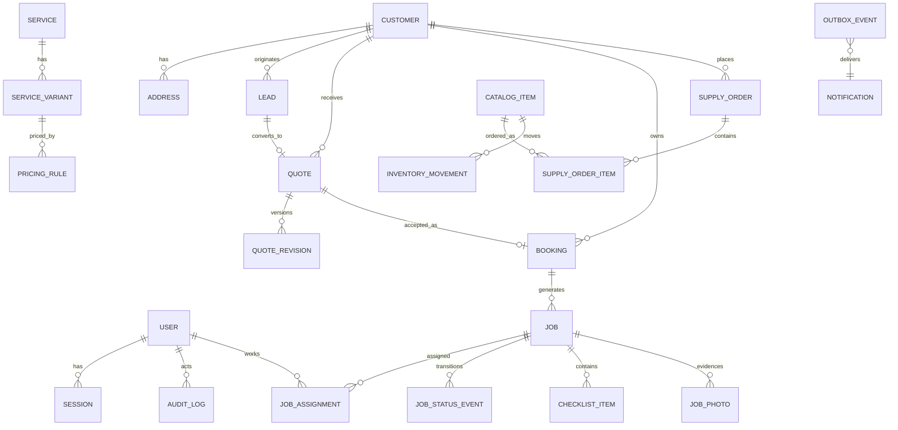

# Shine Hygiene Operations Platform — Solution Architecture Document

| Field | Value |
|---|---|
| Status | Draft for review |
| Version | 0.1 |
| Date | 2026-11-17 |
| Related | `docs/PRD.md`, `docs/UX-DESIGN-BRIEF.md` |
| Current production | `https://shine-hygiene-flame.vercel.app`; last merge `e47d7bd`; API smoke `GET /api/leads` → 405, `/` → 200 on 2026-11-17 |

## 1. Context

The live product is a Vite/React single-page application with one Vercel Function (`POST /api/leads`) writing to Neon. It is useful for validating the quote and lead-capture hypothesis, but it cannot safely support the target product:

- No server-rendered customer or staff surfaces.
- No authentication, sessions, roles, or row-level scoping.
- No operations data model beyond `leads`.
- Business logic is split between the SPA and a hand-written function; pricing duplication is a known risk.
- No scheduling, assignment, job evidence, notifications, audit, or retention controls.
- Public SEO depends on client rendering; offline caches can serve stale shells.
- Every new operational feature would require another ad-hoc function and more duplicated rules.

The target is **one full-stack application** with clear domain, server, and presentation boundaries. The current SPA remains live until a verified cutover.

## 2. Architecture decision

### 2.1 Decision

Adopt **Next.js App Router on Vercel**, with:

- **React Server Components** for public marketing, SEO, and authenticated read-heavy pages.
- **Client components** only for the quote wizard, calendar, dashboard interactions, and field actions.
- **Server Actions** for authenticated mutations from the ops console.
- **Route Handlers** for public APIs, webhooks, cron, and health checks.
- **Neon Postgres** as the system of record, accessed through **Drizzle ORM**.
- **Better Auth** with database-backed sessions for staff and future customer accounts.
- **Zod** schemas shared across client, server actions, and route handlers.
- **Vercel Cron + transactional outbox** for reliable notifications and retention jobs.
- **Resend + React Email** for transactional email; WhatsApp click-to-chat in MVP, Cloud API later.

### 2.2 Why not continue with the SPA

| Concern | Vite SPA + functions | Next.js full-stack |
|---|---|---|
| Auth/session | Custom auth in functions; no established session model | Server sessions, middleware, server-side authorization |
| SEO | Client-rendered; weak crawlability | Server-rendered metadata/content |
| Data access | Each function opens its own connection and logic | Shared repositories and transaction boundaries |
| Validation | Duplicated client/server code | Shared Zod + domain modules |
| Ops UI | Possible, but a second app and auth surface | Same deployable, route groups, shared design system |
| Security | Every endpoint re-implements policy | Central policy module + server actions |
| Deployment | Frontend and API drift | One build, one release, one rollback |

The SPA is not deleted immediately; it is frozen as the migration baseline.

### 2.3 Alternatives considered

| Alternative | Pros | Cons | Verdict |
|---|---|---|---|
| Stay on Vite + add a separate BFF (Express/Fastify) | Keeps existing frontend; clear API boundary | Two deployments, two auth systems, duplicate types, more ops work; still weak SEO | Rejected |
| Remix / React Router framework | Strong server model, progressive enhancement | Smaller Vercel/Neon integration ecosystem; migration effort similar; team familiarity lower | Viable, not chosen |
| Laravel or Django + React | Mature auth/admin ecosystem | Full rewrite of quote domain; splits TypeScript domain/tests; slower | Rejected for this product |
| Supabase (auth + DB + storage) | Fast start, integrated | Ties auth/storage to vendor; existing Neon investment; RLS complexity for ops workflows | Rejected; retain Neon |
| Next.js App Router | SSR/RSC, server actions, Vercel fit, React reuse | Framework coupling; server/client boundary discipline required | **Chosen** |

### 2.4 Consequences

Positive:

- One language and type system across domain, server, and UI.
- Server-rendered public pages with measurable Core Web Vitals.
- Central authorization and audit points.
- Easier progressive enhancement and low-bandwidth delivery.
- Existing quote reducer, tests, and brand tokens can be ported.

Negative:

- Requires disciplined separation between server-only code and client bundles.
- Next.js caching and server-action semantics must be understood by the team.
- Migration is a real project, not a refactor in place.
- Vercel/Neon coupling increases; mitigate with standard Postgres and portable domain code.

## 3. System overview

```text
                         ┌─────────────────────────────────────┐
                         │              Browser                │
                         │ public • customer • staff • field   │
                         └───────────────┬─────────────────────┘
                                         │ HTTPS
                         ┌───────────────▼─────────────────────┐
                         │        Next.js on Vercel            │
                         │                                     │
                         │  (marketing)  RSC + metadata        │
                         │  (quote)      client wizard         │
                         │  (ops)        RSC + server actions  │
                         │  (field)      client actions        │
                         │  /api/public  route handlers        │
                         │  /api/webhooks, /api/cron           │
                         └───────┬───────────────┬─────────────┘
                                 │               │
                    ┌────────────▼──────┐  ┌─────▼──────────────┐
                    │ Domain services   │  │ Auth / policy      │
                    │ pricing, states,  │  │ Better Auth + RBAC │
                    │ validation        │  │ audit              │
                    └────────────┬──────┘  └─────┬──────────────┘
                                 │               │
                    ┌────────────▼───────────────▼─────────────┐
                    │        Drizzle repositories              │
                    │  transactions • scoped queries • mappers  │
                    └──────────────────┬───────────────────────┘
                                       │ pooled TLS
                    ┌──────────────────▼───────────────────────┐
                    │             Neon Postgres                │
                    │  leads • quotes • bookings • jobs • ...  │
                    └──────────────────▲───────────────────────┘
                                       │
          ┌────────────────────────────┴───────────────────────────┐
          │                                                        │
 ┌────────▼────────┐   ┌──────────────────┐   ┌──────────────────▼─┐
 │ Vercel Cron     │   │ Vercel Blob      │   │ Sentry / logs      │
 │ outbox, retain  │   │ private evidence │   │ errors, traces     │
 └────────┬────────┘   └──────────────────┘   └────────────────────┘
          │
 ┌────────▼───────────────────────────────────────────────────────┐
 │ Resend email • WhatsApp click-to-chat (MVP) • Cloud API (P1)  │
 └───────────────────────────────────────────────────────────────┘
```

## 4. Technology choices

| Layer | Choice | Rationale |
|---|---|---|
| Framework | Next.js App Router, current stable | SSR/RSC, server actions, Vercel integration, React reuse |
| Language | TypeScript strict | Shared domain types and safer refactors |
| UI | Tailwind CSS + Radix primitives + local design system | Accessible primitives without a generic component-library look |
| Forms | React Hook Form + Zod | Field-level errors, uncontrolled performance, shared schemas |
| Data | Neon Postgres | Existing investment, serverless-friendly, branching for previews |
| ORM | Drizzle ORM + drizzle-kit | Typed SQL, explicit migrations, low runtime overhead |
| Auth | Better Auth + Drizzle adapter | DB sessions, MFA, roles, no external identity lock-in |
| Validation | Zod | One schema at every trust boundary |
| Email | Resend + React Email | Transactional email with typed templates |
| Files | Vercel Blob (private) | Job photos; signed access; no public buckets |
| Rate limit | Upstash Redis + `@upstash/ratelimit` | Distributed limits across serverless instances |
| Errors | Sentry | Release-aware error and performance tracing |
| Tests | Vitest, Testing Library, Playwright, axe | Unit, component, e2e, accessibility |
| CI | GitHub Actions | Typecheck, lint, tests, build, migration check |
| Runtime | Node.js LTS pinned | Postgres/auth compatibility; avoid Edge for DB transactions |

## 5. Module boundaries

```text
src/
  app/
    (marketing)/          public pages, metadata, sitemap
    (quote)/quote/        quote wizard
    (track)/track/[token] customer status
    (account)/account/    Phase 2 customer account
    (ops)/ops/            authenticated operations console
    (field)/field/        cleaner mobile workflow
    api/
      public/             quote price, booking request, track
      webhooks/           provider callbacks
      cron/               outbox, retention, recurring jobs
      health/
  components/
    ui/                   primitives: button, input, dialog, table
    patterns/             price summary, status badge, empty state
  domain/
    pricing/              pure pricing rules and types
    quote/                quote state machine and defaults
    booking/              booking/job state transitions
    money/                integer minor units, formatting
    validation/           Zod schemas shared by client/server
  server/
    auth/                 Better Auth config, session helpers
    policy/               can(user, action, resource), scopes
    db/                   client, schema, migrations, repositories
    services/             lead, quote, booking, job, supply, notification
    audit/                audit writer
    outbox/               enqueue, dispatch, retry
  lib/                    dates, phone, references, result types
db/
  schema/                 Drizzle table definitions
  migrations/             generated SQL, reviewed
  seed/                   local/dev seed only
emails/                   React Email templates
tests/
  unit/ integration/ e2e/ a11y/
```

Rules:

- `domain/` has no database, network, React, or environment access. It is deterministic and portable.
- `server/` may import `domain/`; `app/` may import both; `domain/` imports neither.
- Client components never import `server/` or secrets. Enforce with lint boundaries and `server-only`.
- Public route handlers call services; they do not contain business rules.
- Repositories enforce scoping; UI hiding is never the authorization boundary.

## 6. Data model

### 6.1 Conventions

- Primary keys: UUIDv7 or ULID for sortable, non-guessable IDs. Human references are separate.
- Money: `integer` cents + `currency char(3)`. No floats.
- Timestamps: `timestamptz`, stored UTC; display in `Africa/Harare`.
- Soft delete only where audit/legal requires it; otherwise explicit status.
- Every mutable business table has `created_at`, `updated_at`, and `version` where optimistic concurrency matters.
- PII columns are explicitly classified and excluded from logs.
- Migrations are additive, reviewed, and applied before code that depends on them.

### 6.2 Entity relationship overview



### 6.3 Core tables

| Table | Key fields | Notes |
|---|---|---|
| `users` | id, email, name, role, status, mfa_enabled, last_login_at | Staff and future customers; invite-only for staff |
| `sessions` | id, user_id, token_hash, expires_at, ip_hash, user_agent | Better Auth; revocable |
| `customers` | id, type, name, company, primary_phone, email, consent, owner_id | Person or organisation |
| `addresses` | id, customer_id, line1, suburb, city, access_notes, lat, lng, zone_id | Service location |
| `leads` | id, reference, client_request_id, customer_id, source, service_id, status, assignee_id, estimated_value_cents, next_follow_up_at, converted_quote_id | Extends existing table; `client_request_id` unique |
| `lead_notes` | id, lead_id, author_id, channel, outcome, body, created_at | Immutable timeline |
| `services` | id, slug, name, vertical, active, sort_order | Residential, commercial, office, car, supplies |
| `service_variants` | id, service_id, name, unit, min_quantity, active | Size/frequency/property variants |
| `pricing_rules` | id, variant_id, version, config jsonb, effective_from, effective_to, created_by | Versioned; never edited in place |
| `addons` | id, service_id, name, price_cents, unit, active | Extras |
| `travel_zones` | id, name, fee_cents, active | Harare zones |
| `quotes` | id, reference, customer_id, lead_id, status, current_revision_id, currency, total_cents, expires_at | Commercial quote |
| `quote_revisions` | id, quote_id, version, pricing_snapshot jsonb, subtotal_cents, discount_cents, tax_cents, total_cents, created_by, reason | Immutable snapshot of inputs and totals |
| `bookings` | id, reference, customer_id, quote_id, status, requested_start_at, confirmed_start_at, duration_minutes, address_id, notes | Confirmed commitment |
| `jobs` | id, booking_id, reference, status, scheduled_start_at, scheduled_end_at, address_id, supervisor_id | Executable visit |
| `job_assignments` | id, job_id, user_id, role, start_at, end_at, assigned_at | `start_at`/`end_at` copied from the job; exclusion constraint prevents overlap |
| `job_status_events` | id, job_id, from_status, to_status, actor_id, reason, created_at | Append-only |
| `checklist_items` | id, job_id, label, required, completed_at, completed_by, note | Per-job snapshot of template |
| `job_photos` | id, job_id, kind, blob_key, content_type, size_bytes, uploaded_by | Private blob; signed access |
| `supply_orders` | id, reference, customer_id, status, delivery_address_id, total_cents, confirmed_at | Order request/confirmation |
| `supply_order_items` | id, order_id, catalog_item_id, quantity, unit_price_cents | Price snapshot |
| `catalog_items` | id, sku, name, price_cents, stock_on_hand, active | HygieneMart |
| `inventory_movements` | id, catalog_item_id, delta, reason, ref_type, ref_id, actor_id | Append-only stock ledger |
| `business_settings` | id, key, value jsonb, updated_by | Singleton-ish settings |
| `business_hours` | id, weekday, open_time, close_time, active | Sunday inactive |
| `blackout_dates` | id, date, reason | Holidays |
| `outbox_events` | id, type, payload jsonb, status, attempts, next_attempt_at, last_error | Transactional delivery |
| `notifications` | id, channel, recipient, template, payload, status, provider_id | Delivery record |
| `audit_log` | id, actor_id, action, entity_type, entity_id, before jsonb, after jsonb, request_id, ip_hash, created_at | Append-only |
| `idempotency_keys` | key, scope, request_hash, response jsonb, expires_at | Duplicate-safe public submissions |
| `reference_counters` | scope, period, next_value | Human-readable references |

### 6.4 Constraints and integrity

- `leads.client_request_id` unique.
- `quotes.reference`, `bookings.reference`, `jobs.reference`, `supply_orders.reference` unique.
- `quote_revisions.total_cents >= 0`; line arithmetic checked in domain and database where feasible.
- `jobs.scheduled_end_at > jobs.scheduled_start_at`.
- `job_assignments` exclusion constraint on `(user_id, tstzrange(start_at, end_at))` to prevent overlapping assignments. Requires `btree_gist`.
- `inventory_movements` never updated or deleted; stock is derived or guarded by a transactional counter.
- Status transitions are validated in the domain and recorded in `job_status_events` / `audit_log`.
- Deleting a customer is a workflow, not a cascade: anonymize PII, retain financial/job records as required, log the action.

## 7. Authentication and authorization

### 7.1 Staff authentication

- Invite-only accounts created by owner/admin.
- Email + password with Argon2id hashing; optional but enforced TOTP for owner/admin.
- Database-backed sessions; HttpOnly, Secure, SameSite=Lax cookie; rotation on privilege change.
- Session revocation on password reset, role change, or manual “sign out everywhere.”
- Login, reset, and invite endpoints rate-limited.
- No shared staff accounts.

### 7.2 Customer authentication

MVP:

- No account required.
- A signed, expiring tracking token is emailed/SMS/WhatsApp-linked after submission.
- Token contains only an opaque booking/lead ID and expiry, signed with HMAC; no PII.
- `/track/[token]` resolves server-side and returns only the fields permitted for that booking.
- Reschedule/cancel creates a request; it does not mutate the booking directly.

Phase 2:

- Magic-link customer accounts via Resend.
- Account access is optional; the token flow remains for guests.

### 7.3 RBAC

Roles: `owner`, `ops`, `cleaner`, `customer`.

Policy is a server module:

```ts
can(actor, "quote.override", quote)
can(actor, "job.assign", job)
can(actor, "customer.export", { scope })
```

Enforcement:

- Middleware redirects unauthenticated users, but server actions/handlers re-check.
- Repositories apply scope: cleaner → assigned jobs; customer → own records; ops → all operational records; owner → all.
- Sensitive fields (internal notes, full contact details, cost/margin) are selected explicitly per role.
- Separation of duties: pricing rules and refunds owner-only; high discounts require owner approval.
- Every privileged mutation writes an audit event in the same transaction.

## 8. State machines

### 8.1 Lead

```text
new → contacted → qualified → quoted → won
  │        │           │         │
  └────────┴───────────┴─────────┴→ lost
```

- `new` → `contacted`: contact attempt recorded.
- `contacted` → `qualified`: service/area/budget confirmed.
- `qualified` → `quoted`: quote created and sent.
- `quoted` → `won`: booking confirmed.
- Any active state → `lost`: reason required.
- Reopening a lost lead is allowed with audit and reason.

### 8.2 Quote

```text
draft → sent → accepted
  │       │  └→ declined
  │       └→ expired
  └→ cancelled
```

- Only `draft` is editable; edits create a new revision.
- Sending freezes the current revision.
- Acceptance links to a booking; a quote cannot be accepted twice.
- Expiry is evaluated server-side, not only by a client timer.

### 8.3 Booking

```text
requested → confirmed → completed
     │          │  └→ cancelled
     │          └→ no_show
     └→ declined
```

- `requested` is not a promise of service.
- Confirmation requires a capacity-held slot and an assigned team or explicit unassigned flag.
- Cancellation after confirmation records reason and actor.

### 8.4 Job

```text
unassigned → assigned → accepted → en_route → checked_in → in_progress → completed → verified
      │          │           │           │            │             │
      └──────────┴───────────┴───────────┴────────────┴─────────────┴→ blocked / cancelled
```

- Only assigned cleaners or ops can transition execution states.
- `completed` requires required checklist items and evidence rules.
- `verified` is an ops action; it is the quality gate.
- `blocked` records a reason and notifies ops.

### 8.5 Supply order

```text
requested → confirmed → preparing → fulfilled
     │           │           └→ cancelled
     └→ declined
```

Stock is decremented only when the order is fulfilled, or reserved explicitly in Phase 2.

## 9. Key flows

### 9.1 Quote pricing and submission

1. Client wizard sends the quote state to `POST /api/public/quotes/price` on step transitions (debounced).
2. Server validates the discriminated state with Zod and recomputes using the active pricing version.
3. Response includes a signed `pricing_token` containing version and total hash, plus display breakdown.
4. On submit, the client sends the state, idempotency key, and pricing token.
5. Server re-validates, re-prices, compares the token, creates/updates customer and lead in a transaction, writes outbox event, returns reference.
6. If the pricing version changed, the server returns `PRICE_CHANGED` with a refreshed breakdown; the customer must review, not silently accept.

The client still computes locally for responsiveness using the same pure domain module. The server remains authoritative.

### 9.2 Lead to booking

1. Ops opens lead; contact attempt is appended.
2. “Convert to quote” creates a draft quote linked to the lead, with a pricing snapshot.
3. Ops adjusts permitted inputs; totals recompute.
4. “Send quote” freezes revision and queues email/WhatsApp handoff.
5. Acceptance (staff-recorded or customer link) moves quote to `accepted`.
6. “Confirm booking” runs a transaction: re-check slot capacity, create booking + job, assign staff, create audit and outbox events.
7. Confirmation email and track link are sent.

### 9.3 Assignment conflict prevention

- `job_assignments` stores `start_at`/`end_at` copied from the job for exclusion checking.
- Confirmation and reassignment run in a transaction with `SELECT ... FOR UPDATE` on the job and an insert that can fail on the exclusion constraint.
- On conflict, return `ASSIGNMENT_CONFLICT` with alternative staff/slots; never save a partial assignment.
- Ops can intentionally assign a team to the same job; the constraint is per user, not per job.

### 9.4 Outbox and notifications

- Business transaction inserts an `outbox_events` row.
- Vercel Cron calls `/api/cron/outbox` every minute with a shared secret.
- Worker claims rows with `FOR UPDATE SKIP LOCKED`, renders template, sends via provider, records attempt.
- Exponential backoff; max attempts → dead letter + alert.
- Provider webhooks update delivery status.
- Email failure never rolls back the lead/booking.

### 9.5 Track link

- Token = signed payload `{ kind, id, exp }` using HMAC-SHA256 and a server secret.
- Server resolves token, loads the permitted projection, and renders a status page.
- Invalid/expired tokens return a neutral recovery page; no existence leak.
- Reschedule/cancel writes a request row and queues ops notification; it does not change the booking state.

## 10. API and contracts

### 10.1 Public route handlers

| Method | Route | Purpose | Protections |
|---|---|---|---|
| POST | `/api/public/quotes/price` | Validate and price a quote state | Rate limit, Zod, size limit |
| POST | `/api/public/bookings` | Submit quote/booking request | Idempotency-Key, rate limit, honeypot |
| GET | `/api/public/track/[token]` | Retrieve permitted booking status | Signed token, rate limit |
| POST | `/api/public/track/[token]/requests` | Request reschedule/cancel | Signed token, rate limit, Zod |
| POST | `/api/public/supply-orders` | Supply order request | Rate limit, Zod |
| GET | `/api/health` | Liveness/readiness | No PII; minimal detail |
| GET | `/api/webhooks/[provider]` | Provider verification | Signature check |
| POST | `/api/cron/outbox` | Dispatch notifications | `CRON_SECRET` |
| POST | `/api/cron/retention` | Retention/anonymization | `CRON_SECRET` |

Legacy `POST /api/leads` remains temporarily for the current SPA, then redirects/deprecates after cutover.

### 10.2 Authenticated mutations

Use Server Actions for ops and field mutations:

- `createLeadNote`, `convertLeadToQuote`, `updateQuoteDraft`, `sendQuote`, `recordQuoteAcceptance`.
- `confirmBooking`, `rescheduleBooking`, `assignJob`, `transitionJob`.
- `completeChecklistItem`, `uploadJobPhoto`, `reportJobIssue`.
- `updatePricingRule`, `inviteStaff`, `changeRole`, `requestExport`.

Every action:

1. Resolves session server-side.
2. Checks policy for the specific resource.
3. Validates with Zod.
4. Runs service + transaction.
5. Writes audit/outbox.
6. Revalidates affected paths.
7. Returns a typed result, not a raw exception.

### 10.3 Response contract

```ts
type Ok<T> = { ok: true; data: T; requestId: string };
type Err = {
  ok: false;
  error: {
    code: string;
    message: string;
    fieldErrors?: Record<string, string[]>;
    retryable: boolean;
  };
  requestId: string;
};
```

Error codes include `VALIDATION_FAILED`, `PRICE_CHANGED`, `DUPLICATE_REQUEST`, `RATE_LIMITED`, `UNAUTHORIZED`, `FORBIDDEN`, `NOT_FOUND`, `ASSIGNMENT_CONFLICT`, `SLOT_UNAVAILABLE`, `PROVIDER_UNAVAILABLE`, `INTERNAL`.

User-facing messages are plain language; internal codes are for logs and tests.

## 11. Validation, idempotency, and money

- Zod schemas live in `domain/validation` and are used by the wizard, server actions, and route handlers.
- The quote state is a discriminated union; invalid cross-vertical combinations fail before pricing.
- Phone numbers normalized to E.164 for storage/WhatsApp; display formatted locally.
- Dates validated against business hours, blackout dates, timezone, and minimum notice.
- `Idempotency-Key` is required for public submissions. Store key + request hash + response; same key + different body → `409`.
- Duplicate detection also uses `leads.client_request_id` as a second guard.
- All money is integer cents. Domain functions accept and return cents; formatting is a presentation concern.
- Quote revisions store the full pricing snapshot, including rule version, inputs, line items, discounts, and total. Historical quotes never change when rules change.
- Tax is explicit: `tax_cents` and `tax_rate` are zero/absent until confirmed; never infer VAT.

## 12. Availability and scheduling

MVP:

- Customer chooses a preferred slot; request is `requested`, not confirmed.
- Ops confirms manually after checking staff and capacity.
- Business hours and blackout dates block invalid requests.
- Capacity rules are configuration: max jobs per slot, team size, travel buffer.
- DB constraints prevent overlapping staff assignments at confirmation.

Phase 2:

- Real-time availability endpoint computes open slots from capacity, staff skills, existing jobs, and buffers.
- Holds expire; confirmation converts a hold transactionally.
- Self-serve reschedule only offers valid alternatives.

No route optimization in MVP. Travel zones affect price and scheduling buffers, not sequencing.

## 13. Security and privacy

### 13.1 Threat model highlights

- Spam/abuse of public quote and lead endpoints.
- Enumeration of tracking tokens or customer records.
- Privilege escalation through client-trusted role fields.
- Price tampering or replay.
- IDOR on job photos, exports, and customer records.
- PII leakage through logs, error trackers, URLs, or emails.
- Staff account takeover.
- Malicious file upload.
- Webhook forgery.

### 13.2 Controls

- TLS everywhere; HSTS; secure cookies.
- CSP with nonces/hashes; no unsafe-inline in production where feasible.
- Zod validation and output projection; never spread database rows into responses.
- Parameterized queries via Drizzle; no string-built SQL.
- Session + policy checks in every server action and route handler.
- Rate limits per IP, per session, and per phone/email where appropriate.
- Idempotency and replay protection.
- Signed, short-lived URLs for private blobs; content-type and size limits; image re-encoding before storage.
- Webhook signature verification and timestamp tolerance.
- Audit log append-only; restrict access; retention aligned with policy.
- Secrets in Vercel/Neon only; no `NEXT_PUBLIC_` secrets; secret scanning in CI.
- Dependency updates and vulnerability alerts.

### 13.3 Privacy lifecycle

- Collect only what is needed to quote, schedule, and perform the service.
- Consent captured for marketing separately from service communication.
- Privacy notice linked at the point of phone/email collection.
- Retention job anonymizes expired leads and old records; legal holds override.
- Subject access/deletion requests are workflows with identity verification and audit.
- Providers (Vercel, Neon, Resend, Upstash, Sentry) documented with data categories and regions.
- No customer photos in public marketing without explicit consent.

## 14. Performance and low-bandwidth design

- Public routes are server-rendered; core content and metadata do not require hydration.
- Client bundle budget: <200KB gzip initial JS on `/quote`; enforce in CI.
- No heavy UI/animation libraries; CSS transitions only; respect reduced motion.
- Images via `next/image`, responsive sizes, AVIF/WebP, explicit dimensions.
- Quote wizard is a client island; ops pages use RSC for data and small client controls.
- Prefetch only likely next routes; avoid prefetching heavy ops pages on mobile.
- Draft autosave to localStorage; submission queue only with idempotency (Phase 2).
- Service worker, if used for field, caches only static shell and queued actions; never caches PII responses.
- Database queries indexed for inbox, schedule, and tracking paths; avoid N+1.
- Neon pooled connections; no per-request connection storms.

Budgets:

| Metric | Budget |
|---|---|
| LCP (mobile p75) | <2.5s |
| INP (p75) | <200ms |
| CLS | <0.1 |
| Quote route initial JS | <200KB gzip |
| Public HTML TTFB (p75) | <800ms |
| Price endpoint p95 | <300ms |
| Ops list p95 | <1s |

## 15. Observability and operations

- Structured JSON logs: request ID, route, actor ID, role, latency, status, error code. No PII.
- Sentry for exceptions and traces; release tied to commit SHA.
- Audit log for privileged actions; separate from application logs.
- Metrics: quote funnel, lead submission success, outbox backlog, job transitions, assignment conflicts, DB latency, 5xx rate.
- Alerts:
  - Public submission failure rate >2% for 5 minutes.
  - Outbox backlog >50 or oldest >10 minutes.
  - 5xx spike.
  - DB connection saturation.
  - Cron failure.
  - Auth failure spike.
- Runbooks: rollback, restore, outbox replay, provider outage, compromised account.
- Neon PITR enabled; monthly restore drill in staging; record recovery time.
- Health endpoint checks DB and required configuration without exposing secrets.

## 16. Testing and verification

### 16.1 Test layers

| Layer | Scope | Tooling |
|---|---|---|
| Unit | Pricing, discounts, money, quote transitions, phone/date normalization, policy | Vitest |
| Property-based | Money invariants, quote totals, date boundaries, idempotency hashes | fast-check |
| Integration | Repositories, transactions, constraints, outbox, auth scopes | Vitest + ephemeral Neon branch |
| Component | Wizard steps, summary, errors, status badges | Testing Library |
| E2E | Quote→lead→ops→booking→job completion; track; RBAC; reschedule | Playwright |
| Accessibility | Quote, confirmation, track, ops lead, field job | axe + manual keyboard/screen reader |
| Performance | LCP/INP budgets, bundle size, API latency | Lighthouse CI, size-limit, k6 |
| Security | Authz matrix, IDOR, rate limits, file upload, webhook signatures | Integration + targeted tests |
| Migration | Lead backfill counts/checksums, redirects, rollback | Scripted staging rehearsal |

### 16.2 Release gates

- Typecheck, lint, unit, integration, e2e, a11y, build all pass.
- No critical/high dependency vulnerabilities.
- Migration applied and reversible or forward-fix documented.
- Production smoke: `/`, `/quote`, `/api/health`, `/ops` auth redirect, track token.
- Backup restore verified for the release window.
- Rollback deployment identified.

## 17. Migration and cutover

### 17.1 Principles

- No big-bang data migration without a rehearsal.
- Additive schema changes first; deploy code that can tolerate both old and new shapes.
- Keep the current SPA and `POST /api/leads` live until the Next app passes production smoke.
- Preserve SEO and customer links; redirect old paths.
- Keep a rollback window.

### 17.2 Sequence

1. **Freeze baseline:** tag current `main`; record production deployment and DB schema.
2. **Scaffold Next app** on a branch; port design tokens, quote domain, and tests.
3. **Create schema migrations** for new tables and additive `leads` columns; apply to a Neon branch.
4. **Build public + quote + track**; run parity tests against current pricing for representative cases.
5. **Build ops MVP**; seed staging with synthetic data; run RBAC and conflict tests.
6. **Rehearse migration:** copy production leads to staging, verify counts, references, and checksums; test rollback.
7. **Preview verification:** Vercel preview + Neon branch; Playwright and manual mobile checks.
8. **Cutover:** deploy Next to production; keep old deployment available; switch domain if using a subdomain; verify.
9. **Redirects:** `/quote` stays; legacy hash/query routes map to new pages; unknown paths → home/404, not a broken shell.
10. **Cache purge:** invalidate CDN; if a service worker exists, ship a self-destructing worker and force update.
11. **Monitor 7 days:** errors, conversion, lead delivery, outbox, DB.
12. **Decommission SPA** only after the rollback window and owner sign-off.

### 17.3 Data migration notes

- Existing `leads` rows are preserved; map legacy columns to new fields without destructive rewrites.
- Backfill `reference`, `status`, `source`, and timestamps; do not invent customer accounts.
- Unknown/legacy values go to a quarantine report, not silently dropped.
- Test lead `SH-20261117-0C797B06` and any real leads must be preserved; no cleanup script runs against production without explicit approval.
- `client_request_id` remains unique; legacy nulls need a deterministic backfill or nullable handling.

### 17.4 Rollback

- Keep previous Vercel deployment and database backup/PITR point.
- New schema must be backward-compatible for the rollback window, or rollback includes a forward-fix.
- Rollback triggers: lead submission failure, auth outage, data corruption, conversion drop beyond agreed threshold.
- Document the exact rollback command and owner approval.

## 18. Environments and CI/CD

| Environment | App | Database | Purpose |
|---|---|---|---|
| Local | `next dev` | Neon dev branch | Development |
| Preview | Vercel preview | Neon preview branch | PR verification |
| Staging | Vercel staging (optional) | Neon staging branch | Migration rehearsal |
| Production | Vercel production | Neon production | Live |

- Env vars: `DATABASE_URL` (pooled), `DATABASE_URL_UNPOOLED` (migrations), `BETTER_AUTH_SECRET`, `BETTER_AUTH_URL`, `RESEND_API_KEY`, `UPSTASH_REDIS_REST_URL/TOKEN`, `BLOB_READ_WRITE_TOKEN`, `TRACK_TOKEN_SECRET`, `CRON_SECRET`, `SENTRY_DSN`.
- No secret is exposed with `NEXT_PUBLIC_`.
- CI: install, typecheck, lint, unit, integration (Neon branch), build, e2e (preview), a11y, bundle budget.
- Migrations run as a separate deploy step with the unpooled URL; never from a request handler.
- Node version pinned; Vercel project runtime documented.
- Feature flags for risky flows (customer accounts, WhatsApp API, payments).

## 19. Architecture decisions

### ADR-001 — Adopt Next.js App Router as the full-stack target

- **Context:** The SPA cannot support auth, ops, SEO, and shared server logic without accumulating ad-hoc functions.
- **Alternatives:** stay Vite + BFF; Remix; Laravel/Django; Supabase.
- **Decision:** Next.js App Router on Vercel, one deployable.
- **Consequences:** framework coupling and server/client discipline; faster delivery and central policy.
- **Evidence:** current API duplication and missing auth/ops surfaces; production smoke confirms current scope only.

### ADR-002 — Use Neon Postgres with Drizzle ORM

- **Context:** Neon is already provisioned and connected; the domain is relational and transactional.
- **Alternatives:** Prisma; raw SQL; Supabase Postgres.
- **Decision:** Drizzle + explicit SQL migrations; pooled runtime connection, unpooled migrations.
- **Consequences:** more SQL ownership; strong typing and portable Postgres.

### ADR-003 — Staff database sessions; guest tracking tokens for customers

- **Context:** Staff need secure roles; customers need low-friction status without another password.
- **Alternatives:** Clerk/Auth0; customer passwords; SMS OTP.
- **Decision:** Better Auth for staff; signed expiring tracking tokens for guests; magic-link accounts in Phase 2.
- **Consequences:** no external IdP lock-in; token lifecycle and abuse controls must be tested.

### ADR-004 — Transactional outbox for notifications

- **Context:** Email/WhatsApp providers can fail; losing a confirmation is unacceptable.
- **Alternatives:** send inline; fire-and-forget queue.
- **Decision:** outbox row in the business transaction; cron worker with retries and dead letter.
- **Consequences:** eventual delivery and operational monitoring; no lost confirmations on provider outage.

### ADR-005 — Manual booking confirmation at launch

- **Context:** Real-time availability requires trustworthy capacity and staff data that do not yet exist.
- **Alternatives:** instant confirmation; hold-and-expire.
- **Decision:** capture preferred slot, confirm manually; enforce conflicts at confirmation.
- **Consequences:** honest customer expectation; lower technical risk; ops must respond within SLA.

## 20. Open technical questions

1. Exact Neon region and latency to Harare; confirm with a production-like query test.
2. Whether Vercel Node runtime and Neon pooled connections meet the price endpoint p95 target.
3. WhatsApp Cloud API provider path and template approval timeline.
4. Payment gateway choice and reconciliation model.
5. Whether customer accounts are required at launch by the owner.
6. Final retention periods and legal basis.
7. Staff device mix and field connectivity; validate the offline queue design.
8. Whether to preserve the current `api/leads` contract indefinitely for integrations.
